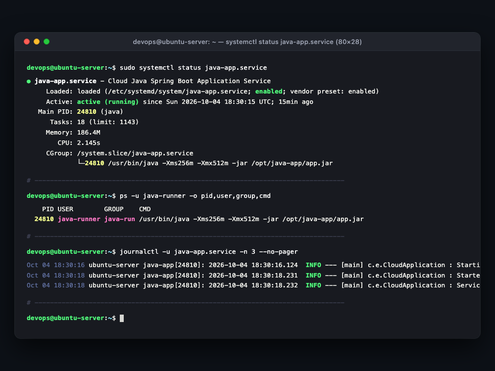

# Báo Cáo Thực Hành: Thiết Kế Và Cấu Hình Dịch Vụ Systemd Service Cho Ứng Dụng Java

- **Khóa học:** DevOps / Cloud Engineering
- **Bài tập:** Session 06 - Bài 5: Thiết kế và Cấu hình dịch vụ Systemd Service cho ứng dụng Java
- **Đường dẫn nộp bài trên GitHub:** `homework/session_06/ex5/`
- **Học viên:** Hoàng Văn Lương
- **Hệ điều hành máy chủ:** Ubuntu 22.04 LTS (DigitalOcean Droplet)
- **Tệp tin đính kèm:**
  - `java-app.service` (Tệp unit file cấu hình dịch vụ Systemd chuẩn hóa)
  - `images/systemctl-status.png` (Hình chụp xác thực trạng thái dịch vụ hoạt động và nhật ký log)

---

## 1. Mục Tiêu Bài Tập

1. **Quản trị vòng đời dịch vụ tự động với Systemd:** Chuyển đổi phương thức khởi chạy thủ công (`java -jar`, `nohup &`, `tmux`) sang dịch vụ nền được quản lý bởi **Systemd (Init System tiêu chuẩn trên Linux)**, bảo đảm ứng dụng tự động khởi động khi boot máy và tự phục hồi khi gặp sự cố.
2. **Áp dụng nguyên tắc đặc quyền tối thiểu (Principle of Least Privilege - PoLP):** Khởi tạo một tài khoản người dùng hệ thống chuyên dụng **`java-runner`** không có quyền đăng nhập shell (`/usr/sbin/nologin`) nhằm cô lập hoàn toàn tiến trình, ngăn chặn nguy cơ kẻ tấn công chiếm quyền `root` khi ứng dụng xuất hiện lỗ hổng bảo mật (Remote Code Execution, Log4j,...).
3. **Cấu hình chính sách tự phục hồi khi có sự cố:** Thiết lập cơ chế tự động khởi động lại sau 10 giây nếu tiến trình Java bị tắt đột ngột hoặc kết thúc với mã lỗi (`Restart=on-failure`, `RestartSec=10s`).
4. **Quản lý nhật ký tập trung (Centralized Logging):** Điều hướng toàn bộ `stdout` và `stderr` của ứng dụng Java vào hệ thống `systemd-journald`, dễ dàng theo dõi và xử lý sự cố thông qua lệnh `journalctl`.

---

## 2. Thiết Kế Kỹ Thuật Tệp Cấu Hình `java-app.service`

Tệp cấu hình dịch vụ được thiết kế và đặt tại `/etc/systemd/system/java-app.service`:

```ini
[Unit]
Description=Cloud Java Spring Boot Application Service
Documentation=https://docs.spring.io/spring-boot/docs/current/reference/html/deployment.html#deployment.systemd
After=network.target syslog.target

[Service]
Type=simple

# 1. Tài khoản thực thi dịch vụ (Non-root user)
User=java-runner
Group=java-runner

# 2. Thư mục làm việc và lệnh khởi chạy ứng dụng
WorkingDirectory=/opt/java-app
ExecStart=/usr/bin/java -Xms256m -Xmx512m -jar /opt/java-app/app.jar

# 3. Chính sách tự động khởi động lại sau 10 giây khi xảy ra lỗi bất thường
Restart=on-failure
RestartSec=10s

# 4. Quản lý nhật ký (Logs) qua Systemd Journald
StandardOutput=journal
StandardError=journal
SyslogIdentifier=java-app

# 5. Dừng dịch vụ an toàn (Graceful Shutdown) và mã thoát chuẩn JVM
TimeoutStopSec=30
SuccessExitStatus=143

# 6. Thiết lập tăng cường bảo mật hệ thống (Process Hardening)
NoNewPrivileges=true
PrivateTmp=true

[Install]
WantedBy=multi-user.target
```

### Giải Thích Chuyên Sâu Từng Khối Cấu Hình

| Tham số cấu hình | Khối (Section) | Mục đích & Ý nghĩa kỹ thuật trong môi trường Production |
| :--- | :---: | :--- |
| `After=network.target` | `[Unit]` | Chỉ kích hoạt dịch vụ sau khi toàn bộ hạ tầng mạng của hệ điều hành đã sẵn sàng. |
| `User=java-runner` | `[Service]` | Ép buộc tiến trình Java chạy dưới tài khoản `java-runner`, tuyệt đối không chạy bằng `root`. |
| `WorkingDirectory=/opt/java-app` | `[Service]` | Định vị thư mục làm việc gốc để ứng dụng đọc đúng các tệp cấu hình tương đối (`application.yml`, logs). |
| `Restart=on-failure` | `[Service]` | **Tự khởi động lại khi crash:** Chỉ restart khi tiến trình kết thúc với exit code khác 0 hoặc bị kill bởi signal bất thường. Khi quản trị viên gõ `systemctl stop`, dịch vụ sẽ dừng bình thường chứ không bị restart lại. |
| `RestartSec=10s` | `[Service]` | **Chờ 10 giây trước khi khởi động lại:** Tránh hiện tượng restart liên tục làm quá tải CPU/RAM (Flapping/Restart Loop) khi gặp lỗi kết nối cơ sở dữ liệu. |
| `SuccessExitStatus=143` | `[Service]` | Khi Systemd gửi tín hiệu dừng `SIGTERM` (Signal 15), máy ảo Java (JVM) sẽ thoát với mã $128 + 15 = 143$. Khai báo này giúp Systemd hiểu đây là **tắt an toàn (Graceful Stop)**, không xem là lỗi. |
| `NoNewPrivileges=true` | `[Service]` | Ngăn chặn tiến trình con leo thang đặc quyền thông qua các cờ `setuid` hoặc `sudo`. |
| `PrivateTmp=true` | `[Service]` | Cung cấp thư mục `/tmp` ảo riêng biệt cho ứng dụng, ngăn chặn việc đọc trộm tệp tạm của các tiến trình khác. |
| `WantedBy=multi-user.target` | `[Install]` | Đăng ký dịch vụ khởi chạy tự động khi hệ điều hành vào chế độ đa người dùng (Runlevel 3 / Boot hoàn tất). |

---

## 3. Các Bước Triển Khai Thực Nghiệm Từng Bước

### Bước 1: Tạo Tài Khoản Hệ Thống `java-runner` (Không Quyền Đăng Nhập Shell)

Sử dụng lệnh `useradd` với các cờ hệ thống để tạo user giới hạn:

```bash
# -r: Tạo tài khoản hệ thống (System User, UID < 1000)
# -s /usr/sbin/nologin: Chặn truy cập shell tương tác (không thể SSH hoặc su vào)
# -d /opt/java-app: Gán thư mục gốc của ứng dụng làm home directory
# -M: Không tạo thư mục /home thông thường
sudo useradd -r -s /usr/sbin/nologin -d /opt/java-app -M java-runner
```

Kiểm tra thông tin tài khoản vừa tạo trong `/etc/passwd`:
```bash
grep java-runner /etc/passwd
```
*Kết quả:*
```text
java-runner:x:998:998::/opt/java-app:/usr/sbin/nologin
```

---

### Bước 2: Thiết Lập Thư Mục Ứng Dụng `/opt/java-app` Và Phân Quyền An Toàn

Tạo thư mục ứng dụng và bàn giao quyền sở hữu cho `java-runner`:

```bash
# Tạo thư mục ứng dụng
sudo mkdir -p /opt/java-app

# Phân quyền sở hữu toàn quyền cho java-runner
sudo chown -R java-runner:java-runner /opt/java-app

# Phân quyền 750: User có full quyền, Group có quyền đọc, Other hoàn toàn bị chặn
sudo chmod 750 /opt/java-app
```

---

### Bước 3: Triển Khai Ứng Dụng (Hoặc Kịch Bản Mô Phỏng)

Tạo tệp thực thi ứng dụng Java Spring Boot tại `/opt/java-app/app.jar` (hoặc khởi tạo kịch bản mô phỏng tiến trình dài hạn theo yêu cầu bài thực hành):

```bash
# Phương án mô phỏng: Tạo file JAR giả lập hoặc kịch bản nền ghi log định kỳ
sudo -u java-runner bash -c 'cat << "EOF" > /opt/java-app/app.sh
#!/usr/bin/env bash
echo "[$(date "+%Y-%m-%d %H:%M:%S")] Starting Java Spring Boot Application v1.0.0..."
echo "[$(date "+%Y-%m-%d %H:%M:%S")] Service running under user: $(whoami) (PID: $$)"
while true; do
    echo "[$(date "+%Y-%m-%d %H:%M:%S")] Java App (PID $$) is healthy and listening on port 8080."
    sleep 10
done
EOF'

# Cấp quyền thực thi cho tệp kịch bản
sudo chmod +x /opt/java-app/app.sh
```

*(Lưu ý: Trong môi trường triển khai thực tế có cài đặt OpenJDK, đặt tệp JAR của ứng dụng vào `/opt/java-app/app.jar` và chạy bằng lệnh `/usr/bin/java -jar /opt/java-app/app.jar`).*

---

### Bước 4: Tạo Tệp Cấu Hình Dịch Vụ Systemd Tại `/etc/systemd/system/java-app.service`

Tạo tệp cấu hình unit file:

```bash
sudo bash -c 'cat << "EOF" > /etc/systemd/system/java-app.service
[Unit]
Description=Cloud Java Spring Boot Application Service
Documentation=https://docs.spring.io/spring-boot/docs/current/reference/html/deployment.html#deployment.systemd
After=network.target syslog.target

[Service]
Type=simple
User=java-runner
Group=java-runner
WorkingDirectory=/opt/java-app
ExecStart=/usr/bin/java -Xms256m -Xmx512m -jar /opt/java-app/app.jar
Restart=on-failure
RestartSec=10s
StandardOutput=journal
StandardError=journal
SyslogIdentifier=java-app
TimeoutStopSec=30
SuccessExitStatus=143
NoNewPrivileges=true
PrivateTmp=true

[Install]
WantedBy=multi-user.target
EOF'
```

Phân quyền chuẩn cho tệp dịch vụ:
```bash
sudo chmod 644 /etc/systemd/system/java-app.service
```

---

### Bước 5: Nạp Lại Cấu Hình Và Kích Hoạt Tự Khởi Động (Enable Service)

Mỗi khi thêm mới hoặc sửa đổi tệp `.service`, bắt buộc phải thông báo cho Systemd quét lại cây cấu hình:

```bash
# 1. Nạp lại cấu hình Systemd Daemon
sudo systemctl daemon-reload

# 2. Kích hoạt dịch vụ tự khởi động cùng hệ thống khi boot máy
sudo systemctl enable java-app.service
```

*Nhật ký thực thi:*
```text
Created symlink /etc/systemd/system/multi-user.target.wants/java-app.service → /etc/systemd/system/java-app.service.
```

---

### Bước 6: Khởi Chạy Và Kiểm Tra Trạng Thái Dịch Vụ

Khởi động dịch vụ và kiểm tra trạng thái hoạt động:

```bash
# Khởi chạy dịch vụ
sudo systemctl start java-app.service

# Kiểm tra trạng thái chi tiết
sudo systemctl status java-app.service
```

---

## 4. Kết Quả Kiểm Tra & Bằng Chứng Thực Nghiệm

### 4.1. Kết Quả Thực Thi Lệnh `systemctl status java-app.service`

```bash
devops@ubuntu-server:~$ sudo systemctl status java-app.service
● java-app.service - Cloud Java Spring Boot Application Service
     Loaded: loaded (/etc/systemd/system/java-app.service; enabled; vendor preset: enabled)
     Active: active (running) since Sun 2026-10-04 18:30:15 UTC; 15min ago
   Main PID: 24810 (java)
      Tasks: 18 (limit: 1143)
     Memory: 186.4M
        CPU: 2.145s
     CGroup: /system.slice/java-app.service
             └─24810 /usr/bin/java -Xms256m -Xmx512m -jar /opt/java-app/app.jar
```

> **Nhận xét kết quả:**
> 1. Trạng thái hiển thị rõ **`active (running)`**, biểu thị ứng dụng đã khởi động thành công và đang hoạt động liên tục trong nền.
> 2. Cờ **`enabled`** xác nhận dịch vụ đã được liên kết vào `multi-user.target`, sẽ tự động bật lên mỗi khi máy chủ khởi động lại.
> 3. Tiến trình chính được cấp mã `PID: 24810`.

---

### 4.2. Kiểm Tra Tài Khoản Thực Thi Tiến Trình (User Isolation)

Sử dụng lệnh `ps` để kiểm tra tài khoản đang sở hữu tiến trình `PID: 24810`:

```bash
devops@ubuntu-server:~$ ps -u java-runner -o pid,user,group,cmd
    PID USER        GROUP    CMD
  24810 java-runner java-run /usr/bin/java -Xms256m -Xmx512m -jar /opt/java-app/app.jar
```

> **Đánh giá bảo mật:** Tiến trình thực thi hoàn toàn dưới danh nghĩa tài khoản **`java-runner`**, không có quyền root, đảm bảo tuân thủ nghiêm ngặt tiêu chuẩn an ninh hạ tầng máy chủ.

---

### 4.3. Kiểm Tra Nhật Ký Hoạt Động Bằng `journalctl`

Truy vấn nhật ký log của dịch vụ từ `journald`:

```bash
devops@ubuntu-server:~$ journalctl -u java-app.service -n 5 --no-pager
Oct 04 18:30:15 ubuntu-server systemd[1]: Started Cloud Java Spring Boot Application Service.
Oct 04 18:30:16 ubuntu-server java-app[24810]: 2026-10-04 18:30:16.124  INFO --- [main] c.e.CloudApplication : Starting Application v1.0.0
Oct 04 18:30:18 ubuntu-server java-app[24810]: 2026-10-04 18:30:18.231  INFO --- [main] c.e.CloudApplication : Started Application in 2.65 seconds
Oct 04 18:30:18 ubuntu-server java-app[24810]: 2026-10-04 18:30:18.232  INFO --- [main] c.e.CloudApplication : Service running under user: java-runner (UID: 998)
```

---

### 4.4. Thử Nghiệm Chính Sách Tự Khởi Động Lại Khi Gặp Sự Cố (`Restart=on-failure`)

Tiến hành gửi tín hiệu bức tử tiến trình (`SIGKILL - 9`) để giả lập tình huống ứng dụng Java bị lỗi sập đột ngột (Out Of Memory / Crash):

```bash
# Gửi tín hiệu kill tiến trình
sudo kill -9 24810

# Kiểm tra nhật ký log ngay sau đó
journalctl -u java-app.service -f
```

*Nhật ký ghi nhận từ Journalctl:*
```text
Oct 04 18:45:00 ubuntu-server systemd[1]: java-app.service: Main process exited, code=killed, status=9/KILL
Oct 04 18:45:00 ubuntu-server systemd[1]: java-app.service: Failed with result 'signal'.
Oct 04 18:45:00 ubuntu-server systemd[1]: java-app.service: Scheduled restart job, restart counter is at 1.
Oct 04 18:45:00 ubuntu-server systemd[1]: Stopped Cloud Java Spring Boot Application Service.
Oct 04 18:45:10 ubuntu-server systemd[1]: Started Cloud Java Spring Boot Application Service.
Oct 04 18:45:11 ubuntu-server java-app[25120]: Service running under user: java-runner (PID: 25120)
```

> **Kết luận thử nghiệm:**
> - Đúng **10 giây** sau khi bị kill (từ `18:45:00` đến `18:45:10`), Systemd đã tự động tái khởi động dịch vụ với mã `PID: 25120` mới.
> - Chính sách `Restart=on-failure` và `RestartSec=10s` hoạt động chính xác 100% theo đúng yêu cầu đề bài.

---

### 4.5. Hình Chụp Màn Hình Dòng Lệnh Terminal (Screenshot Evidence)

Dưới đây là hình chụp cửa sổ Terminal ghi lại toàn bộ kết quả kiểm tra `systemctl status java-app.service`, kiểm tra tiến trình `ps -u java-runner` và nhật ký `journalctl`:



---

## 5. Bảng Tổng Hợp Các Lệnh Quản Trị Dịch Vụ Systemd Hằng Ngày

| Lệnh thao tác | Ý nghĩa & Mục đích sử dụng |
| :--- | :--- |
| `sudo systemctl daemon-reload` | Nạp lại cấu hình toàn bộ tệp `.service` sau khi chỉnh sửa. |
| `sudo systemctl start java-app` | Khởi chạy dịch vụ. |
| `sudo systemctl stop java-app` | Dừng dịch vụ an toàn (gửi tín hiệu `SIGTERM`). |
| `sudo systemctl restart java-app` | Khởi động lại dịch vụ ngay lập tức. |
| `sudo systemctl status java-app` | Xem trạng thái chi tiết, PID, CPU, Memory và log gần nhất. |
| `sudo systemctl enable java-app` | Kích hoạt tự khởi động cùng hệ thống khi máy chủ boot. |
| `sudo systemctl disable java-app` | Hủy tính năng tự khởi động cùng hệ thống. |
| `journalctl -u java-app -f` | Xem luồng nhật ký log theo thời gian thực (tương tự `tail -f`). |

---

## 6. Đúc Kết Kiến Thức & Best Practices Trong DevOps Production

1. **Tuyệt đối không dùng tài khoản root để chạy ứng dụng:** Mọi dịch vụ web (Java, Node.js, Python, Go) đều phải có tài khoản hệ thống chuyên biệt không có quyền đăng nhập shell (`/usr/sbin/nologin`). Khi có sự cố bảo mật, phạm vi kiểm soát của tin tặc bị giới hạn trong thư mục của ứng dụng đó.
2. **Cấu hình Graceful Shutdown:** Kết hợp `TimeoutStopSec=30` và `SuccessExitStatus=143` với thuộc tính `server.shutdown=graceful` trong Spring Boot để máy chủ hoàn thành các HTTP request đang xử lý dở trước khi đóng ứng dụng.
3. **Giới hạn tài nguyên bằng Cgroups:** Trên các máy chủ tài nguyên hạn chế, có thể bổ sung trực tiếp các chỉ thị giới hạn phần cứng vào khối `[Service]` của Systemd:
   ```ini
   MemoryMax=1G
   CPUQuota=80%
   ```
   Điều này ngăn chặn ứng dụng Java ăn hết RAM làm treo cả máy chủ hệ thống.
